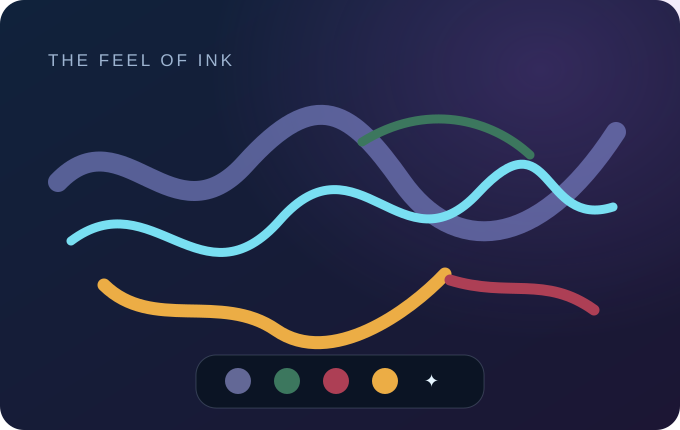

<h1 align="left">
  OverInk
  <a href="https://github.com/xujiegb/OverInk/releases/latest">
    
  </a>
</h1>

<p align="left">
  <strong>写在屏幕上的灵感。</strong><br>
  <sub>Ideas, drawn right on your screen.</sub><br>
  <sub>Vos idées, dessinées directement sur votre écran.</sub>
</p>

<p align="left">
  <a href="https://github.com/xujiegb/OverInk/releases">发行版本 / Releases / Versions</a>
  &nbsp; · &nbsp;
  <a href="https://github.com/xujiegb/OverInk/actions/workflows/build.yml">构建状态 / Builds / Compilations</a>
  &nbsp; · &nbsp;
  <a href="LICENSE">BSD-3-Clause</a>
</p>

<br>

<p align="center">
  
</p>

<h1 align="center">所见之处，即是画布。</h1>

<p align="center">
  <strong>Your screen. Your canvas.</strong><br>
  <sub>Votre écran. Votre toile.</sub>
</p>

<p align="center">
  不打断思路，不离开当前窗口。<br>
  用一支笔，在任何画面上书写、标注与表达。<br>
  <sub>Stay in the moment. Write, annotate, and explain directly over your desktop.</sub><br>
  <sub>Restez dans l’instant. Écrivez, annotez et expliquez directement sur votre bureau.</sub>
</p>

<p align="center">
  <a href="https://github.com/xujiegb/OverInk/releases/latest"><strong>↓ 下载 OverInk · Download OverInk · Télécharger OverInk</strong></a>
</p>

<p align="center">
  <sub>Windows &nbsp; · &nbsp; macOS &nbsp; · &nbsp; Linux &nbsp; · &nbsp; FreeBSD</sub>
</p>

<p align="center">
  
</p>

<p align="center">
  <sub>产品概念示意，非应用实拍 · Concept artwork, not an actual screenshot · Illustration conceptuelle, et non une capture réelle</sub>
</p>

<br>

---

<br>

<h2 align="center">把想法，直接画出来。</h2>

<p align="center">
  <sub>From thought to ink, without interruption.</sub><br>
  <sub>De l’idée au trait, sans interruption.</sub>
</p>

<p align="center">
  课堂讲解、屏幕演示、设计讨论，精彩的想法不必等待下一页。<br>
  <sub>For lessons, presentations, and creative discussions—make every point visible as it happens.</sub><br>
  <sub>Pour les cours, les présentations et les échanges créatifs : montrez chaque idée au moment où elle naît.</sub>
</p>

<table>
  <tr>
    <td width="50%" valign="top">
      
      <h3>落笔，随心而动。</h3>
      <p><sub>Ink that follows your hand.<br>Une encre qui suit votre geste.</sub></p>
      <p>感知压感与笔的倾角，让轻重变化自然融入每一笔。</p>
      <p><sub>Pressure and tilt input add expressive variation to every stroke.<br>La pression et l’inclinaison apportent des nuances à chaque trait.</sub></p>
    </td>
    <td width="50%" valign="top">
      
      <h3>精彩瞬间，随手留下。</h3>
      <p><sub>Capture what matters.<br>Conservez l’essentiel.</sub></p>
      <p>框选屏幕区域，保存 PNG 截图，让重点随时可回顾。</p>
      <p><sub>Select a screen area and save a PNG for later.<br>Sélectionnez une zone de l’écran et enregistrez-la en PNG.</sub></p>
    </td>
  </tr>
</table>

<p align="center">
  <sub>以上插画用于说明功能，并非真实运行截图。<br>These are feature illustrations, not actual application screenshots.<br>Ces visuels illustrent les fonctions ; il ne s’agit pas de captures de l’application.</sub>
</p>

<br>

<h2 align="center">需要的工具，恰好都在。</h2>

<p align="center">
  <sub>Everything you need. Nothing in your way.</sub><br>
  <sub>Tout ce qu’il faut, sans vous gêner.</sub>
</p>

<table>
  <tr>
    <td width="50%" valign="top">
      <h3>✎ 书写与强调</h3>
      <p><sub>Draw &amp; highlight<br>Dessiner et surligner</sub></p>
      <p>画笔、铅笔、荧光笔、橡皮擦、激光笔以及线条与形状工具，让演示更清楚。</p>
      <p><sub>Pens, pencils, highlighters, erasers, a laser pointer, lines, and shapes.<br>Stylos, crayons, surligneurs, gomme, pointeur laser, lignes et formes.</sub></p>
    </td>
    <td width="50%" valign="top">
      <h3>▣ 自由文字</h3>
      <p><sub>Editable text<br>Texte modifiable</sub></p>
      <p>创建、移动、缩放、修改文本框，并按需要调整字体。</p>
      <p><sub>Create, move, resize, and edit text boxes with font selection.<br>Créez, déplacez, redimensionnez et modifiez vos zones de texte et leur police.</sub></p>
    </td>
  </tr>
  <tr>
    <td width="50%" valign="top">
      <h3>↗ 标注与操作，自由切换</h3>
      <p><sub>Annotate or interact<br>Annoter ou interagir</sub></p>
      <p>随时返回鼠标操作，不必退出标注环境；支持撤销、重做与清除。</p>
      <p><sub>Switch to mouse interaction without leaving the overlay; undo, redo, or clear marks.<br>Passez à la souris sans quitter la superposition ; annulez, rétablissez ou effacez les annotations.</sub></p>
    </td>
    <td width="50%" valign="top">
      <h3>▤ 为多屏而设计</h3>
      <p><sub>Across displays<br>Sur plusieurs écrans</sub></p>
      <p>面向多显示器与不同桌面环境，关注输入体验和色彩呈现。</p>
      <p><sub>Designed for multiple displays, native input, and thoughtful color handling.<br>Conçu pour plusieurs écrans, les entrées natives et un rendu soigné des couleurs.</sub></p>
    </td>
  </tr>
</table>

<br>

---

<br>

<h2 align="center">熟悉的桌面，自由的表达。</h2>

<p align="center">
  <sub>Four operating systems. One natural way to annotate.</sub><br>
  <sub>Quatre systèmes. Une façon naturelle d’annoter.</sub>
</p>

<p align="center">
  <strong>Windows &nbsp; · &nbsp; macOS &nbsp; · &nbsp; Linux &nbsp; · &nbsp; FreeBSD</strong>
</p>

<p align="center">
  使用 Rust 2024、egui 和 SDL3 构建。Linux 同时考虑 Wayland 与 X11，部分桌面功能可能需要系统授权或额外集成。<br>
  <sub>Built with Rust 2024, egui, and SDL3. Linux supports Wayland/X11 integration; some features may require desktop permissions or additional setup.</sub><br>
  <sub>Développé avec Rust 2024, egui et SDL3. Sous Linux, l’intégration Wayland/X11 peut nécessiter des autorisations ou une configuration supplémentaire.</sub>
</p>

<h3 align="center">架构支持 · Architecture targets · Architectures ciblées</h3>

| 系统 / OS / Système | x64 | x86 | arm64 | riscv64 | loong64 | ppc64le | s390x |
| :-- | :--: | :--: | :--: | :--: | :--: | :--: | :--: |
| **Windows** | ✓ | ✓ | ✓ | — | — | — | — |
| **macOS** | ✓ | — | ✓ | — | — | — | — |
| **Linux** | ✓ | ✓ | ✓ | ✓ | ✓ | ✓ | ✓ |
| **FreeBSD** | ✓ | ✓ | ✓ | ✓ | — | ✓ | — |

<p align="center">
  <sub>✓ 已配置的构建目标，不代表每个发布版本都包含对应文件。<br>✓ Configured build targets; individual releases may offer different files.<br>✓ Cibles de compilation configurées ; les fichiers disponibles peuvent varier selon la version.</sub>
</p>

<h3 align="center">选择适合你的版本。</h3>

<p align="center">
  <sub>Find your download.<br>Choisissez votre version.</sub>
</p>

| 系统 / OS / Système | 发布格式 / Packages / Formats |
| :-- | :-- |
| **Windows** | 安装程序 ` .exe `、便携压缩包 ` .zip ` · Installer & portable ZIP · Installation et archive ZIP |
| **macOS** | 磁盘映像 ` .dmg `、应用压缩包 ` .zip ` · Disk image & app ZIP · Image disque et archive de l’app |
| **Linux** | Debian ` .deb `、RHEL 系 ` .rpm `、` .tar.gz ` · Debian/RHEL packages & archive · Paquets Debian/RHEL et archive |
| **FreeBSD** | ` .tar.gz ` · Archive · Archive |

<p align="center">
  <sub>macOS 目标最低版本为 11.0；Linux 的 DEB 基于 Debian 13，RPM 基于 UBI 10；FreeBSD 构建目标使用 14.4（x86）及 15.1（其他列出的架构）。<br>macOS deployment target: 11.0. DEB builds target Debian 13, RPM builds UBI 10; FreeBSD targets 14.4 (x86) and 15.1 (other listed architectures).<br>Version macOS minimale ciblée : 11.0. Paquets DEB : Debian 13 ; RPM : UBI 10 ; FreeBSD : 14.4 (x86) et 15.1 (autres architectures indiquées).</sub>
</p>

<br>

---

<br>

<h2 align="center">现在，就让灵感留下痕迹。</h2>

<p align="center">
  <sub>Make your point.<br>Donnez forme à vos idées.</sub>
</p>

<p align="center">
  从官方 Releases 获取对应系统的安装包，按需选择架构。<br>
  <sub>Get the package for your system and processor from the official Releases page.</sub><br>
  <sub>Téléchargez la version adaptée à votre système et à votre processeur depuis la page officielle des versions.</sub>
</p>

<p align="center">
  <a href="https://github.com/xujiegb/OverInk/releases/latest"><strong>↓ 立即下载 · Download · Télécharger</strong></a>
  &nbsp;&nbsp;·&nbsp;&nbsp;
  <a href="https://github.com/xujiegb/OverInk/releases">历史版本 · All releases · Toutes les versions</a>
</p>

<details>
<summary><strong>从源代码构建 · Build from source · Compiler depuis les sources</strong></summary>

<br>

需要 Rust 1.100.0 或更新版本，并安装系统对应的原生开发依赖。  
<sub>Requires Rust 1.100.0 or later and the native dependencies for your platform.</sub>  
<sub>Nécessite Rust 1.100.0 ou une version ultérieure et les dépendances natives de votre plateforme.</sub>

```bash
cargo build --locked --release
```

各平台的具体构建步骤、依赖与打包方式请参阅 [GitHub Actions 构建工作流](.github/workflows/build.yml)。  
<sub>See the GitHub Actions workflow for platform-specific build and packaging steps.</sub>  
<sub>Consultez le workflow GitHub Actions pour la compilation et la création des paquets selon la plateforme.</sub>

</details>

<details>
<summary><strong>桌面集成说明 · Desktop integration · Intégration au bureau</strong></summary>

<br>

在部分 Linux Wayland 桌面上，截图或窗口交互可能需要门户授权或桌面扩展。请根据应用提示完成相关设置。  
<sub>Some Linux Wayland desktops may require portal permissions or a desktop extension for screen capture or window interaction. Follow the application prompts.</sub>  
<sub>Certains bureaux Linux Wayland peuvent exiger des autorisations du portail ou une extension pour les captures et les interactions avec les fenêtres. Suivez les indications de l’application.</sub>

</details>

<br>

---

<br>

<p align="center">
  
</p>

<h2 align="center">每一笔，都值得被看见。</h2>

<p align="center">
  <sub>Every idea deserves to be seen.</sub><br>
  <sub>Chaque idée mérite d’être vue.</sub>
</p>

<p align="center">
  <sub>
    <a href="https://github.com/xujiegb/OverInk">源代码 · Source code · Code source</a>
    &nbsp; · &nbsp;
    <a href="https://github.com/xujiegb/OverInk/issues">反馈 · Issues · Signaler un problème</a>
    &nbsp; · &nbsp;
    <a href="LICENSE">BSD-3-Clause</a>
  </sub>
</p>

<p align="center">
  <sub>OverInk 采用 BSD-3-Clause 许可。内置 OpenMoji 资源适用 CC BY-SA 4.0；其他字体授权见 <a href="assets/fonts/OFL.txt">OFL.txt</a>。<br>
  OverInk is BSD-3-Clause licensed. Bundled OpenMoji assets use CC BY-SA 4.0; see <a href="assets/fonts/OFL.txt">OFL.txt</a> for other font terms.<br>
  OverInk est sous licence BSD-3-Clause. Les ressources OpenMoji intégrées sont sous CC BY-SA 4.0 ; voir <a href="assets/fonts/OFL.txt">OFL.txt</a> pour les autres polices.</sub>
</p>
