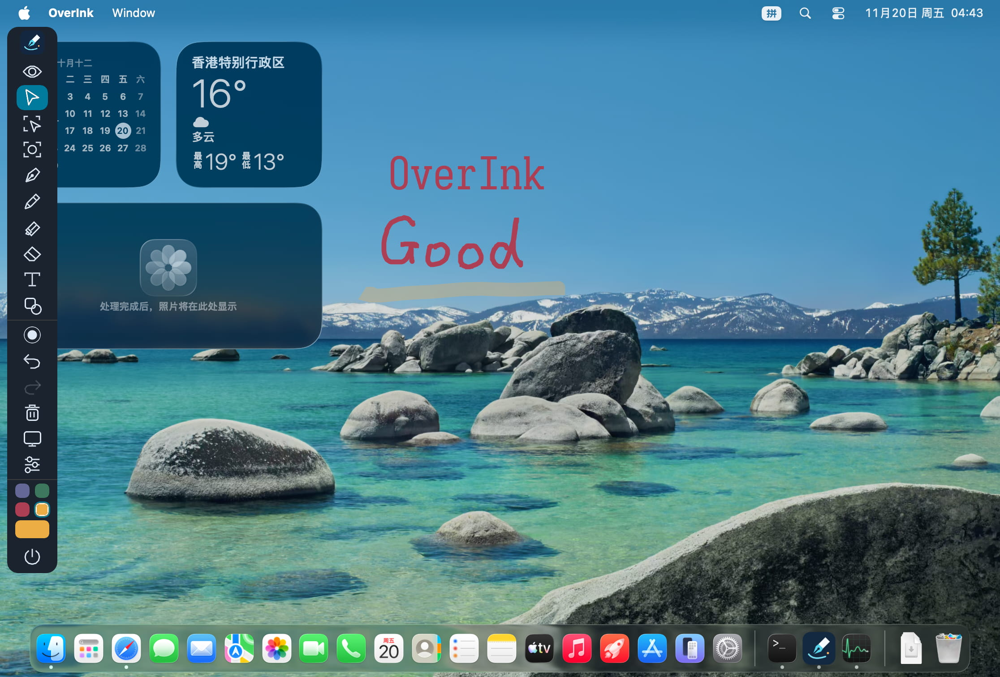

<h1 align="left">
  OverInk
  
</h1>

  <strong>Made by v2rayN</strong> 
  

  <a href="https://github.com/xujiegb/OverInk/releases">发行版本 / Releases / Versions</a>
  &nbsp; · &nbsp;
  <a href="LICENSE">BSD-3-Clause</a>

 

  

<h1 align="center">写在屏幕上的灵感</h1>

  <strong>Ideas, drawn right on your screen</strong> 
  Vos idées, dessinées directement sur votre écran

  <a href="https://github.com/xujiegb/OverInk/releases/latest"><strong>↓ 下载 OverInk · Download OverInk · Télécharger OverInk</strong></a>

  Windows &nbsp; · &nbsp; macOS &nbsp; · &nbsp; Linux &nbsp; · &nbsp; FreeBSD

  

 

## Supported Platforms / Plateformes compatibles / 支持平台

| Platform / 平台 | x64 | x86 | arm64 | riscv64 | loong64 | ppc64le | s390x |
| --- | :---: | :---: | :---: | :---: | :---: | :---: | :---: |
| Windows |  |  |  | - | - | - | - |
| Linux |  |  |  |  |  |  |  |
| FreeBSD |  |  |  |  | - |  | - |
| macOS |  | - |  | - | - | - | - |

---
