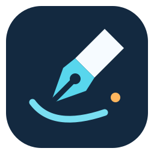
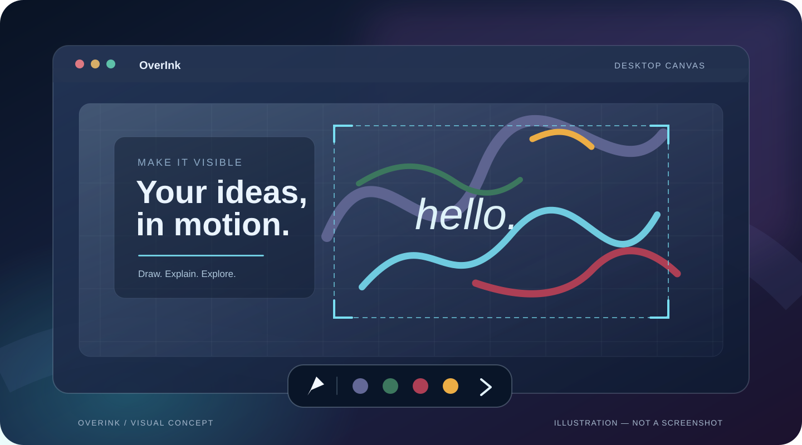
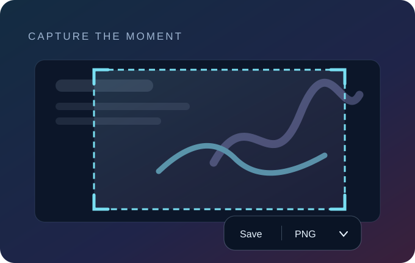

<p align="center">
  
</p>

<h1 align="center">OverInk</h1>

<h2 align="center">屏幕所见，随心落笔。</h2>

<p align="center">
  <sub>Write naturally, right over your screen.</sub><br>
  <sub>Écrivez naturellement, directement sur votre écran.</sub>
</p>

<p align="center">
  用笔迹连接想法与画面。无需切换到另一张画布。<br>
  <sub>Bring ideas and visuals together—without leaving what you're doing.</sub><br>
  <sub>Reliez vos idées à ce que vous voyez, sans quitter votre travail.</sub>
</p>

<p align="center">
  <a href="https://github.com/xujiegb/OverInk/releases/latest"><strong>获取 OverInk · Download · Télécharger</strong></a>
  &nbsp;·&nbsp;
  <a href="https://github.com/xujiegb/OverInk/releases">所有版本 · All releases · Toutes les versions</a>
</p>

<p align="center">
  <sub>Windows &nbsp; · &nbsp; macOS &nbsp; · &nbsp; Linux &nbsp; · &nbsp; FreeBSD</sub>
</p>

<p align="center">
  
</p>

<p align="center">
  <sub>功能视觉示意 · Product concept illustration · Illustration du concept</sub>
</p>

<br>

---

<br>

<h2 align="center">把屏幕，变成你的画布。</h2>

<p align="center">
  <sub>Your screen is the canvas.</sub><br>
  <sub>Votre écran devient votre toile.</sub>
</p>

<p align="center">
  演示中的重点、课堂上的思路、会议里的灵感。<br>
  直接在桌面和应用程序上标注，让表达始终跟得上思考。<br>
  <sub>Highlight what matters in a lesson, presentation, or meeting—directly over your desktop and apps.</sub><br>
  <sub>Soulignez l’essentiel d’un cours, d’une présentation ou d’une réunion, directement sur le bureau et vos applications.</sub>
</p>

<br>

<table>
  <tr>
    <td width="50%" valign="top">
      <h3>每一笔，都有感觉。</h3>
      <p><sub>Every stroke feels personal.</sub><br><sub>Chaque trait a son caractère.</sub></p>
      <p>支持压感与倾角输入，让数字书写保留笔的自然变化。</p>
      <p><sub>Pressure- and tilt-aware input brings nuance to handwriting and sketching.</sub><br><sub>La pression et l’inclinaison donnent de la nuance à l’écriture et au croquis.</sub></p>
    </td>
    <td width="50%" valign="top">
      <h3>工具齐全，操作轻盈。</h3>
      <p><sub>The right tool, right there.</sub><br><sub>Le bon outil, à portée de main.</sub></p>
      <p>钢笔、铅笔、荧光笔、橡皮擦、激光笔，以及线条和形状工具，随时切换。</p>
      <p><sub>Pen, pencil, highlighter, eraser, laser pointer, lines, and shapes—ready when you are.</sub><br><sub>Stylo, crayon, surligneur, gomme, pointeur laser, lignes et formes : tout est à portée de main.</sub></p>
    </td>
  </tr>
  <tr>
    <td width="50%" valign="top">
      <h3>写字，也可以很自由。</h3>
      <p><sub>Words have room to move.</sub><br><sub>Les mots prennent leur place.</sub></p>
      <p>创建、移动、缩放和重新编辑文本框，配合字体选择表达更多内容。</p>
      <p><sub>Add, move, resize, and edit text boxes, with font selection when you need it.</sub><br><sub>Ajoutez, déplacez, redimensionnez et modifiez vos zones de texte, avec le choix de la police.</sub></p>
    </td>
    <td width="50%" valign="top">
      <h3>想操作，就操作。</h3>
      <p><sub>Back to your desktop in a moment.</sub><br><sub>Retrouvez votre bureau en un instant.</sub></p>
      <p>在标注和鼠标操作之间切换，保留讲解节奏，不让工具打断工作。</p>
      <p><sub>Switch between annotation and mouse interaction without breaking your flow.</sub><br><sub>Passez de l’annotation à l’utilisation de la souris sans interrompre votre élan.</sub></p>
    </td>
  </tr>
  <tr>
    <td width="50%" valign="top">
      <h3>重要画面，随手留下。</h3>
      <p><sub>Capture the moment.</sub><br><sub>Capturez l’instant.</sub></p>
      <p>选择屏幕区域、保存 PNG 截图，也能撤销或重做你的标注。</p>
      <p><sub>Select a screen region, save a PNG, and undo or redo annotations.</sub><br><sub>Sélectionnez une zone de l’écran, enregistrez-la en PNG et annulez ou rétablissez vos annotations.</sub></p>
    </td>
    <td width="50%" valign="top">
      <h3>一个屏幕，不必是全部。</h3>
      <p><sub>Made for more than one display.</sub><br><sub>Pensé pour plusieurs écrans.</sub></p>
      <p>为多显示器工作流而设计，兼顾不同桌面系统与显示环境。</p>
      <p><sub>Designed for multi-monitor workflows and different desktop environments.</sub><br><sub>Conçu pour les configurations multi-écrans et différents environnements de bureau.</sub></p>
    </td>
  </tr>
</table>

<br>

<h2 align="center">每一种表达，都值得被看见。</h2>

<p align="center">
  <sub>See ideas take shape.</sub><br>
  <sub>Donnez forme à vos idées.</sub>
</p>

<table>
  <tr>
    <td width="50%" valign="top">
      
      <h3>落笔，自有分寸。</h3>
      <p><sub>Ink that follows your hand.</sub><br><sub>Des traits qui suivent votre geste.</sub></p>
      <p>从细腻线条到醒目强调，让内容在眼前自然呈现。</p>
      <p><sub>From delicate marks to bold emphasis, keep your ideas visible.</sub><br><sub>Des traits subtils aux accents marqués, vos idées prennent vie.</sub></p>
    </td>
    <td width="50%" valign="top">
      
      <h3>捕捉，恰到好处。</h3>
      <p><sub>Keep the moment that matters.</sub><br><sub>Gardez l’essentiel.</sub></p>
      <p>框选屏幕区域，留下需要分享或回顾的重点。</p>
      <p><sub>Select an area and save what matters for later.</sub><br><sub>Sélectionnez une zone et conservez l’essentiel.</sub></p>
    </td>
  </tr>
</table>

<p align="center">
  <sub>以上为界面概念示意，并非实际运行截图；可直接替换为真实截图。</sub><br>
  <sub>Concept illustrations, not actual application screenshots. Real screenshots can replace them.</sub><br>
  <sub>Illustrations conceptuelles, et non des captures réelles. Elles pourront être remplacées.</sub>
</p>

<br>

---

<br>

<h2 align="center">原生桌面，各有精彩。</h2>

<p align="center">
  <sub>At home on your desktop.</sub><br>
  <sub>À sa place sur votre bureau.</sub>
</p>

<p align="center">
  <strong>Windows &nbsp;&nbsp; macOS &nbsp;&nbsp; Linux &nbsp;&nbsp; FreeBSD</strong>
</p>

<p align="center">
  基于 Rust、egui 与 SDL3 构建，关注原生输入、跨平台体验和显示细节。<br>
  Linux 桌面同时考虑 Wayland 与 X11；不同桌面环境的部分功能可能需要额外授权或集成。<br>
  <sub>Built with Rust, egui, and SDL3, with attention to native input and display behavior.</sub><br>
  <sub>Linux integration considers both Wayland and X11; some desktop features may require permissions or additional integration.</sub><br>
  <sub>Développé avec Rust, egui et SDL3, avec une attention particulière aux entrées natives et à l’affichage.</sub><br>
  <sub>Sous Linux, Wayland et X11 sont pris en compte ; certaines fonctions peuvent nécessiter des autorisations ou une intégration supplémentaire.</sub>
</p>

<p align="center">
  <sub>Rust 2024 &nbsp; / &nbsp; egui &nbsp; / &nbsp; SDL3 &nbsp; / &nbsp; sRGB · Display P3 · HDR-aware workflows</sub>
</p>

<br>

---

<br>

<h2 align="center">现在，就开始表达。</h2>

<p align="center">
  <sub>Make your point.</sub><br>
  <sub>Donnez vie à vos idées.</sub>
</p>

<p align="center">
  从 Releases 选择适合你系统与处理器架构的版本。具体可下载文件以对应版本页面为准。<br>
  <sub>Choose the package for your operating system and architecture from Releases. Availability varies by release.</sub><br>
  <sub>Choisissez le paquet adapté à votre système et à votre architecture dans les versions publiées. Les fichiers disponibles varient selon la version.</sub>
</p>

<p align="center">
  <a href="https://github.com/xujiegb/OverInk/releases/latest"><strong>前往下载 · Get OverInk · Obtenir OverInk</strong></a>
</p>

<details>
<summary><strong>从源代码构建 · Build from source · Compiler depuis les sources</strong></summary>

<br>

需要 Rust 1.100.0 或更新版本，以及对应平台所需的原生开发依赖。  
<sub>Requires Rust 1.100.0 or later and platform-specific native build dependencies.</sub>  
<sub>Nécessite Rust 1.100.0 ou une version ultérieure, ainsi que les dépendances natives de votre plateforme.</sub>

```bash
cargo build --locked --release
```

构建配置与各平台依赖可参考 [GitHub Actions 构建流程](https://github.com/xujiegb/OverInk/blob/master/.github/workflows/build.yml)。  
<sub>See the GitHub Actions workflow for platform-specific build details.</sub>  
<sub>Consultez le workflow GitHub Actions pour les détails de compilation propres à chaque plateforme.</sub>

</details>

<br>

---

<br>

<p align="center">
  
</p>

<h2 align="center">让表达，回到直觉。</h2>

<p align="center">
  <sub>Annotation, made intuitive.</sub><br>
  <sub>L’annotation, tout simplement intuitive.</sub>
</p>

<p align="center">
  <sub>
    <a href="LICENSE">BSD 3-Clause</a>
    &nbsp; · &nbsp;
    <a href="https://github.com/xujiegb/OverInk">Source · 源代码 · Code source</a>
    &nbsp; · &nbsp;
    <a href="https://github.com/xujiegb/OverInk/issues">反馈 · Issues · Signaler un problème</a>
  </sub>
</p>

<p align="center">
  <sub>第三方字体及其许可信息见 <a href="LICENSE">LICENSE</a> 与 <a href="assets/fonts/OFL.txt">字体许可说明</a>。</sub><br>
  <sub>Third-party font credits and licenses are documented in the repository.</sub><br>
  <sub>Les crédits et licences des polices tierces figurent dans le dépôt.</sub>
</p>
